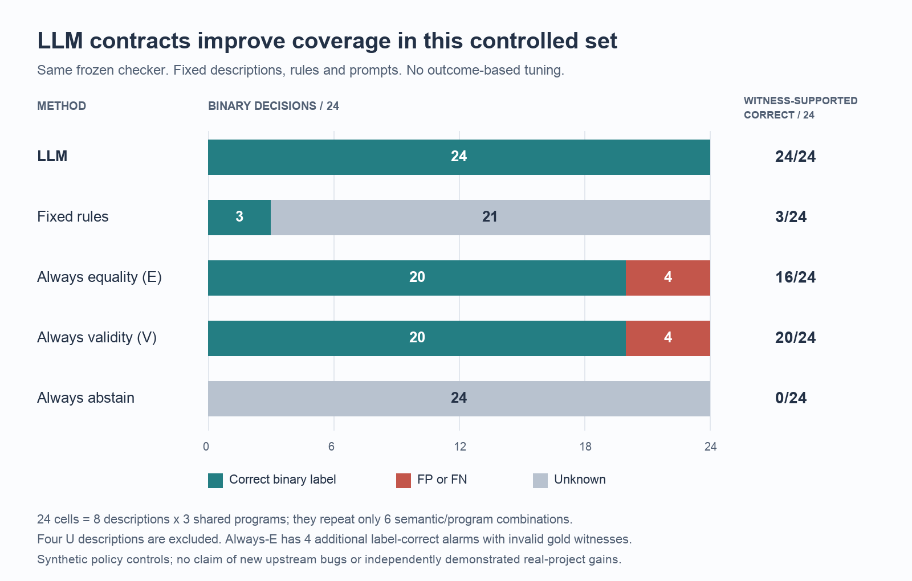

# 自动化补充实验：契约提取是否改善冻结分析器的决策

**结论：在这批受控政策描述中，LLM 相比固定规则提供了可复核的检测覆盖收益。** LLM 的契约语义分类为 12/12，规则为 5/12；24 个有标准 E/V 契约的下游组合中，LLM 得到 24 个正确且具有相应证据的决策，规则得到 3 个正确决策和 21 个 Unknown。21 个配对改善全部来自弃答变为正确决策，其中新增 10 个有标准契约反例支持的报警和 11 个必要条件认证；没有修复规则已有的误报或漏报，因为本轮规则没有作出这两类错误决定。

本实验新增了一个**受控条件下的正结果**。它不改写此前真实项目实验的负结果或不确定结论，也不证明跨项目泛化、节省人工、新发现上游 bug 或分析引擎能力增强。描述、规则与提示在预检前冻结；没有按结果调参、替换题目、重试模型或修改分析器。

## 设计与冻结

12 条描述由研究者借助 AI 编写，四种表达结构各含 E、V、U 三种政策；不是从真实项目收集的独立任务说明。E 要求与规范布尔参考相等，V 仅要求布尔 token，U 明确允许任意文本，因此当前接口没有可支持的非空义务。E 已蕴含 V，E 与 E+V 只在评分时归为同一语义类，实际传给编译器的原始列表、顺序和数字表示均未修改。

规则作者只看六条开发描述及固定 schema/profile；测试描述作者未查看规则、开发材料或输出。两路设计并行完成，最终同时封存，未声称严格的先规则冻结、后测试编写时序。独立预模型审查检查了全部描述、规则与脚本。它认为标签清楚、规则包含实际的否定/范围/格式覆盖机制，但六条开发描述主要是直接措辞，仍是很小的开发集。所有作者与审查者均为 AI 辅助，不称为独立人类金标准。

三个程序分别是以前已研究的真实 truthiness 函数、收集到的 equality 修复提案，以及既有测试中的作者构造 token-only 函数，均原样复制。描述与程序交叉配对是实验构造，不是上游真实任务关联；修复提案也不声称是已发布修复。

方法冻结 SHA256：`e41d4c6f41cdf2710b18626c680dd20ca1a3e9510ab2a2b231df6a795b18ef16`。模型输出冻结 SHA256：`53e4bd50a17cca13638a47f67efa608377e984448050bc2e815cb3afdc0a3ec3`。冻结清单包含全部 20 个方法文件及旧依赖哈希；所有正式规则预测、LLM 请求和下游比较都发生在该冻结后。

## 六组合预检

| 原样保留的程序 | E：相等义务 | V：合法 token 义务 |
|---|---|---|
| equality | no_alarm | no_alarm |
| token_only | alarm | no_alarm |
| truthiness | alarm | alarm |

六项全部与预先推导的标准矩阵相符：3 alarm、3 no_alarm，无 Unknown。预检保存了全部路径证书、27 个程序—固定输入观测及 54 个 E/V 来源推导检查；27 个输入加一项来源生成的新反例共执行 28 次原生调用，重复输入使用明确记录的缓存。报警反例在独立子进程实际执行，义务真假由另一段简单谓词计算；观察到的 reward 不作为静态分析输入。未发现反例不被当作安全证明。

这里仅审核 `reward >= 1 ⇒ 必要义务`。no_alarm 不等于完整评分政策正确：equality 在 V 政策下可能不给另一个合法标签满分；token_only 也会拒绝某些大小写/空白变体。这些“少给分”行为不属于本轮检查目标。

## 完整比较结果

| 条件 | 契约类别正确 | TP | FP | FN | TN | Unknown | 反例／证书支持的正确决策 |
|---|---:|---:|---:|---:|---:|---:|---:|
| 标准契约 | 12/12 | 12 | 0 | 0 | 12 | 0 | 24/24 |
| 固定规则提取 | 5/12 | 2 | 0 | 0 | 1 | 21 | 3/24 |
| LLM 提取 | 12/12 | 12 | 0 | 0 | 12 | 0 | 24/24 |
| 始终 E | 4/12 | 12 | 4 | 0 | 8 | 0 | 16/24 |
| 始终 V | 4/12 | 8 | 0 | 4 | 12 | 0 | 20/24 |
| 始终弃答 | 4/12 | 0 | 0 | 0 | 0 | 24 | 0/24 |

契约类别分母是全部 12 条描述；TP/FP/FN/TN/Unknown 分母仅为 8 条 E/V 描述 × 3 个程序 = 24。TP/FN 描述是否发现过度奖励违约，TN 只表示未违反该必要条件。Unknown 单列，不能改称正确拒绝或普通 FN；若计算“包含弃答的正例召回”，规则为 2/12、LLM 为 12/12，而不是把未知正例排除。

图中的绿色是普通二元标签正确数，右栏另核对报警的具体反例是否真的违反标准契约。固定 E 有 4 个 FP；另有 4 个 truthiness 报警虽然碰巧落在有缺陷的程序上，其返回的反例仅违反错误添加的 E，未违反标准 V，因此右栏只有 16/24。固定 V 的 4 个 FN 发生在 E 政策的 token_only 程序上。

U 的 4 条描述 × 3 个程序 = 12 个结果单列：LLM 和规则均正确弃答、没有无依据义务，也都返回行政性 Unknown；这些不是静态 TN。固定 E/V 在 U 上各产生 12 个无依据契约结果，分别产生 8/4 个无依据报警，不计入上表的二元 bug 分母。

| 描述 | 表达家族 | 标准类别 | 规则 | LLM |
|---|---|---|---|---|
| P17 | distributed_requirements | V | U | V |
| P23 | direct_instruction | U | U | U |
| P28 | conditional_policy | E | E | E |
| P35 | direct_instruction | V | U | V |
| P42 | distributed_requirements | E | U | E |
| P46 | direct_instruction | E | U | E |
| P59 | scope_negation | U | U | U |
| P62 | conditional_policy | U | U | U |
| P73 | distributed_requirements | U | U | U |
| P84 | scope_negation | E | U | E |
| P91 | scope_negation | V | U | V |
| P96 | conditional_policy | V | U | V |

按描述计，LLM 在 8 条非空契约描述上都得到三个有证据的正确决策，规则仅 1 条；7 条描述获益、1 条持平。四条 U 均持平。24 个下游格子重复了仅 6 种语义—程序组合，不是 24 个独立案例或漏洞，不计算基于独立同分布假设的显著性结论。

## 具体反例与收益归因

**P84：正确性政策，token_only 程序。** 文本只允许相对正确参考改变大小写或首尾空白，且拒绝相反标签。LLM 选择 E+V，规则因无法识别该表达而弃答。输入 `answer="False"`、`reference="True"` 时实际 reward=1：V 为真、E 为假。LLM 静态报警明确违反 `equals_reference`；规则 Unknown；固定 V 为 no_alarm，构成 FN。这是从有语义的契约提取到具体违约发现的完整链条，但没有新增分析器运算能力。

**P91：仅格式政策，token_only 程序。** 描述明确不以正确参考的一致性作为满分条件。相同输入 `False` / `True` 仍返回 1，但标准 V 为真，所以没有受检违约。LLM 只选择 V，静态给出 no_alarm；规则 Unknown；固定 E 的报警是假阳性。该例说明“总选最强契约”不能代替提取政策。

**P91：仅格式政策，truthiness 程序。** 固定 E 返回 `False` / `True` 作为反例，但它符合标准 V，不能凭程序确实还有其他 bug 就把这个反例算作有效证据。LLM 的 V 检查返回非布尔 token `__not_a_boolean_token__` / `True`，实际 reward=1 且 V 为假，才是有效反例。所有返回反例和固定探针的原生奖励、逐义务真假、源码跨度及静态记录保存在 [完整 witness 表](results/comparison/witnesses.json)；[代表性记录](analysis/representative-cases.json)仅供阅读，不替代全量结果。

## 为什么规则大多弃答

规则在开发集的 6 条描述上通过检查，但在测试集只识别出 P28 的 E；其他 7 条非空政策均弃答，保存的理由都是“未识别到肯定的、受支持的要求”。从固定规则结构可见有界主语—谓词匹配、命令式格式表达和同句条件等覆盖限制，但本轮未记录逐模式匹配轨迹，不把每个失败强行归因于某一条正则。四条 U 也以同样理由弃答：标签正确不代表规则理解了它们的开放文本政策。结果反映这套有限措辞规则的覆盖不足，而非证明所有规则方法都做不到；设计者未在看到这 21 个 Unknown 后增加同义词或调正则。

因此，本轮相对规则的收益是**更广的自然语言契约覆盖带来更多正确静态决策**，不是修复了错误的符号推理，也不是规则误报率降低。LLM 同时超过始终 E/V 的固定政策，但差异仍受三类作者政策的构造限制。

## 请求成本与服务边界

正式请求 12 次，完成 12 次：8 次提取、4 次弃答，无失败或准入拒绝，无重试。原始回答、事件消息与接收契约一致，事件审计没有接受任何工具操作。服务记录输入 303,662 tokens、输出 1,834 tokens，缓存输入 83,328 是输入子集，不重复相加；报告的 reasoning output 为 0。请求延迟之和 84.8577 秒，三并发批次实际跨度 32.8394 秒，两者都不是人工用时。

这些只统计实验提取调用，不含设计、编程、参考编写和审查的 AI 使用。CLI 0.147.0 沿用默认服务，12 次均未暴露精确模型标识，温度与种子未记录，美元成本未知。输入 token 包含未完整观测的服务上下文，不能声称仅为显式描述 tokens。stderr 保留了技能安装、models-cache schema 和 Notion MCP 启动认证等实际警告/错误；各请求仍以退出码 0 完成并通过无操作事件审计，不能把环境称为无错误或完全隔离。公开可检查的是显式请求没有标签/源码/参考契约以及没有接受模型工具调用，并非对隐含上下文或训练污染的证明。

## 冻结与可复现性

新实验目录与旧交付分开。21 项新增开发／计分测试通过，6 组合预检通过，保存结果重算通过。旧分析器、编译器和验证器的哈希保持不变，47,285 个先前存在的文件全部匹配初始快照。此前 ACM 报告及其压缩包未更新，本报告是独立补充材料。

默认运行 `python3 -B run_study.py verify-saved` 仅核对保存文件和计数，不调用模型、评分函数或分析器。详细组织和操作记录见 [README](README.md)。标准库足够核验；制图另外使用已安装的 Pillow，无新依赖安装。

推荐对论文的表述是：**A frozen controlled study found that LLM-selected contracts improved witness-supported decision coverage over a fixed rule extractor, without changing the symbolic checker. The benefit arose entirely from resolving extraction abstentions; real-project generalization remains unestablished.** 原有真实评测的负结果与 Unknown 仍需保留，不能用本轮受控结果替换。
