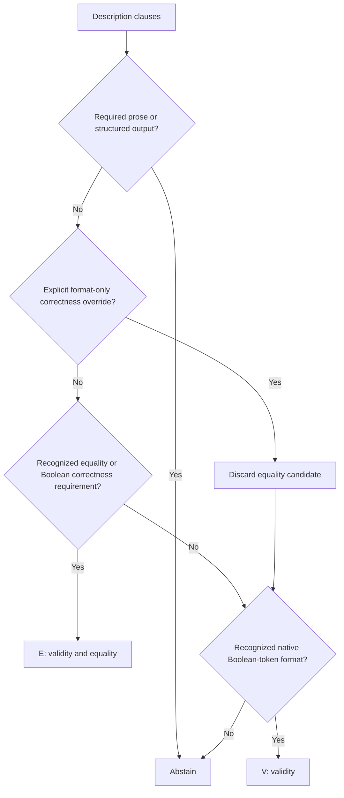

# Fixed English rule extractor

This baseline is authored against exactly six development descriptions in `dev-cards.json`: two E, two V, and two U. It makes no model calls, executes no reward program, imports no analyzer, and reads no held-out cards, labels, or evaluation results. The only existing experiment material consulted was the frozen response schema and analysis profile in `reward-contract-e2e-v1/protocol/`.

The public function is `extract(task, profile=None)`. Policy text comes exclusively from the string `task.question_description`; `placeholder_notes` is ignored. The task identifier is copied. The optional profile must preserve the eight frozen bindings. Extra metadata such as `note` is omitted from the emitted contract. The default profile copies the frozen values directly, avoiding dependency on another extractor or analyzer.

## Meaning and precedence

| Result | Obligations | Justification |
| --- | --- | --- |
| E | `valid_boolean_token`, `equals_reference` | Required agreement with the trusted canonical reference, or an explicit correct/accurate Boolean-answer requirement. Equality entails token validity under the supplied strip/lower normalization. |
| V | `valid_boolean_token` | A recognized native Boolean-token output restriction without a surviving equality requirement. |
| U | None; `status: abstain`, `contract: null` | Output outside the contract language, or no recognized affirmative supported obligation. |



Rules are evaluated once, with stable source order deciding among multiple evidence quotes. The extractor does not use task IDs or expected development labels to choose obligations.

1. **Clause and evidence handling.** Split on sentence-ending punctuation, semicolons, and newlines; retain exact source spans. Analysis lowercases text and normalizes typographic quotes/dashes and quoting around True/False. Evidence always uses the untouched source clause, never reconstructed text.
2. **Boolean context.** Recognize the word `Boolean` or a paired True/False enumeration joined by `or`, `and`, `/`, comma, or vertical bar. Correctness-only rules require Boolean context somewhere in the description. An explicit reference-equality requirement may stand alone because the fixed profile already establishes the reference as canonical True/False.
3. **Reference equality.** A bounded clause must name an answer/response/output/submission/label/token/prediction, assert matching/equality/agreement with a reference, ground truth, answer key, gold answer, expected answer, or canonical answer, and carry a requirement/full-credit cue or an output imperative. The subject-to-predicate and predicate-to-reference windows are each at most 65 characters.
4. **Boolean correctness.** Recognize an output imperative requesting a correct/accurate answer or label; an answer subject with `must`, `shall`, `should`, `needs to`, or `has to` be correct/accurate; or a full-credit/maximum-score condition using `only if` or `requires` and correct/accurate. These are bounded lexical constructions, not open-ended semantic interpretation.
5. **Native token format.** Within a Boolean clause, recognize an output imperative with `only`, `exactly`, `just`, `single`, or `one`; a modal requirement for an answer to be/contain/consist of a single/valid/only token; a bare imperative such as `Answer True or False`; or a modal requirement that the answer be a Boolean token or True/False. Mentioning labels in prose without one of these constructions is insufficient.
6. **Local negation and permission.** Each pattern identifies its governing predicate. A nearby negator, optionality, permission (`may`, `can`, `could`, `allowed to`), a negated requirement before the subject, or negation inside the subject-to-predicate span suppresses that candidate. A negative clause does not erase an independent positive requirement elsewhere. This handles the development E card's `Do not return ...` clause without treating all negation as global.
7. **Explicit grading override.** Recognized statements that correctness/accuracy is irrelevant, ignored, not required/checked/graded/scored/evaluated, does not matter, or does not affect the score/reward/grade remove equality. So do explicit grade/score/reward/credit statements depending only/solely/exclusively on format, syntax, or token validity. This override applies across clauses, but it never creates a token-format obligation by itself. Negation before the override predicate blocks the override.
8. **Out-of-scope output.** An affirmative output directive requiring a JSON object/array, dictionary, XML, paragraph, essay, prose, explanation, or Python Boolean has precedence and yields abstention. So do an instruction to explain reasoning and a required appended explanation. Optional or locally negated prose/structure directives do not trigger this branch.
9. **Unknown language.** If neither equality nor token validity survives, abstain. Missing recognized language is not treated as evidence that correctness is irrelevant. There is no fallback classification based on task order, token counts, or labels.

Each extracted obligation has one exact quote and a fixed explanation of the rule. E can quote its equality instruction for validity because canonical equality entails validity; it does not fabricate an additional format instruction. `not_specified` lists unselected obligations, and abstentions explain either incompatible output representation or unsupported language.

## Development coverage and limitations

| Card | Class | Authored distinction |
| --- | --- | --- |
| dev-e1 | E | Explicit reference agreement plus native token format. |
| dev-e2 | E | Correct Boolean label plus a separate negative instruction. |
| dev-v1 | V | Single Boolean token with explicitly irrelevant correctness. |
| dev-v2 | V | Required token format with explicitly format-only grading. |
| dev-u1 | U | Required explanation; True/False words are allowed inside prose. |
| dev-u2 | U | Required JSON object containing a Boolean and explanation. |

The six descriptions are the complete development corpus, not a representative accuracy sample. The unit suite checks these six expected outcomes, exact evidence substrings, response/contract field shape, determinism, input immutability, profile metadata exclusion, and the documented source hash. No additional synthetic policy descriptions are generated by the tests.

The rules do not parse unrestricted English, conditional branches, examples versus operative policy, nested quotation, arbitrary coreference, or logical double negation. Clause splitting can mishandle abbreviations. Character windows intentionally miss distant relationships. Unrecognized paraphrases may produce U. Explicit prose or structure instructions conservatively produce U even where a richer contract language could express some weaker property. Contradictory policies are handled only by the documented format-only and output-representation precedence; this is not a general contradiction resolver. Correctness extraction assumes the experiment's trusted reference represents the correct Boolean label. No claim is made about correctness under a different reference or normalization model.

## Freeze record

Source file: `rule_extractor.py`

SHA-256: `a5df99a95000fc402cd703909bba7d92ff78fdfd36e7f8eff0be67ebbee5ab85`

Development verification command:

```sh
PYTHONDONTWRITEBYTECODE=1 python3 -B -m unittest discover -s experiments/reward-contract-controlled-v1/tests -p test_rule_extractor.py -v
```

The first development run exposed a spelling-alternation bug: `matches?` did not recognize `match`. It was corrected to `match(?:es)?` before freeze; no held-out evidence was consulted. The final development run passed all four checks, covering all six cards.

After the final successful development run and delivery to the experiment owner, this extractor and its development corpus are frozen. Held-out outcomes must not be used to modify them.
